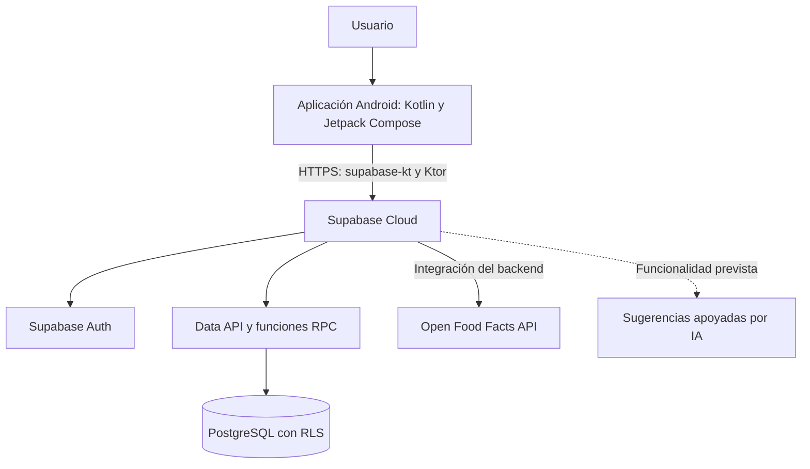

# Up Up Progress!

**Proyecto de título — Ingeniería en Informática**  
**Equipo:** Franco Manríquez y Javier Loaiza

## Descripción del proyecto

**Up Up Progress!** es una aplicación móvil nativa para Android orientada a personas que desean organizar sus entrenamientos, registrar su alimentación y observar su progreso físico en un mismo lugar. Busca reducir la dispersión de información entre distintas herramientas y facilitar el seguimiento de objetivos como **aumentar masa muscular, reducir peso o mantenerlo**.

El sistema contempla la creación de rutinas, el registro de ejercicios, series, repeticiones y cargas, el seguimiento del peso corporal, y el registro de alimentos con calorías y macronutrientes. Incorpora consultas de productos mediante **Open Food Facts** y contempla sugerencias apoyadas por inteligencia artificial a partir de los registros. Las sugerencias son orientativas: el usuario decide si las aplica; la aplicación no modifica automáticamente sus rutinas ni sus objetivos.

**Estado del proyecto:** en desarrollo e integración. La autenticación con Supabase Auth está implementada; otros módulos, como la configuración inicial del perfil y las metas nutricionales, se encuentran en integración o validación. Las funcionalidades planificadas no deben interpretarse como terminadas.

## Tecnologías utilizadas

| Área | Tecnologías |
| --- | --- |
| Aplicación Android | Kotlin 2.4.21, Jetpack Compose, Material Design 3 |
| Desarrollo y compilación | Android Studio, Android Gradle Plugin 9.4.1, Gradle 9.6 |
| Backend y nube | Supabase Cloud (BaaS), Supabase Auth, Data API y funciones PostgreSQL (RPC) |
| Base de datos y seguridad | PostgreSQL, Row Level Security (RLS) |
| Comunicación Android/backend | supabase-kt 3.8.0 y Ktor 3.5.1 |
| Información de alimentos | API de Open Food Facts (integración mediante el backend) |
| Diseño | Figma |
| Versionamiento y colaboración | Git, GitHub |
| Organización del trabajo | Trello y Carta Gantt |
| Pruebas de interfaz | Android Emulator (Pixel 7) |

La funcionalidad de sugerencias con **IA** forma parte del alcance del proyecto; el proveedor o modelo específico debe documentarse cuando quede confirmado.

## Arquitectura de la solución

La solución utiliza una arquitectura **cliente móvil + backend como servicio (BaaS)**. Android presenta la interfaz y reúne las acciones del usuario. Supabase administra la autenticación y expone servicios de datos y funciones que trabajan sobre PostgreSQL. Las políticas RLS restringen el acceso a los datos personales. Open Food Facts se utiliza para consultar información nutricional desde la integración de backend.



Los datos del usuario se organizan en entidades como `profiles`, `user_goals`, `body_weight_logs`, rutinas, entrenamientos y registros de alimentos. El registro de cuenta se realiza mediante Supabase Auth, mientras que la información del perfil y sus metas se almacena en las tablas correspondientes.

## Ejecución local

> **Importante:** este repositorio contiene actualmente documentación y evidencias de las fases del proyecto, **no el código fuente compilable de Android**. Por ello, clonarlo permite consultar los entregables, pero **no ejecutar la aplicación directamente**. Para una reproducción completa, el equipo debe publicar aquí el proyecto Android o agregar el enlace a su repositorio de implementación.

### Obtener este repositorio de documentación

```bash
git clone https://github.com/JavierPelao/Loaiza_Manriquez_Capstone.git
cd Loaiza_Manriquez_Capstone
```

### Preparar y ejecutar la aplicación Android

Una vez que se disponga de la **carpeta del proyecto Android** (la que contiene `settings.gradle.kts`, `gradlew` y el módulo `app`):

1. Instalar **Android Studio** y el **Android SDK API 36**; configurar un emulador Android compatible (se utiliza Pixel 7 en el desarrollo).
2. Abrir en Android Studio la **carpeta raíz del proyecto Android**, no la carpeta de evidencias de este repositorio.
3. Crear el archivo `supabase.properties` en esa raíz, usando únicamente los valores **publicables** del proyecto Supabase autorizado:

   ```properties
   SUPABASE_URL=https://TU-PROYECTO.supabase.co
   SUPABASE_PUBLIC_KEY=TU_CLAVE_PUBLICABLE
   ```

4. Comprobar que `supabase.properties` está excluido de Git mediante `.gitignore`. **Nunca** utilizar claves `service_role` ni `sb_secret_` en la aplicación.
5. Sincronizar Gradle (**Sync Project with Gradle Files**), seleccionar el emulador y ejecutar la configuración `app`.
6. Para probar las funciones que requieren autenticación o datos, utilizar una cuenta de pruebas habilitada en el proyecto Supabase correspondiente.

La ejecución completa depende también de que las tablas, políticas RLS y funciones necesarias estén desplegadas en Supabase Cloud. No se incluyen credenciales reales en este documento.

**Pendiente para completar la reproducibilidad:** agregar la ubicación del código fuente Android y cualquier configuración adicional que requiera la versión final entregada.

## Integrantes y roles

| Integrante | Responsabilidades principales |
| --- | --- |
| **Franco Manríquez** | Desarrollo de la aplicación Android, interfaces con Jetpack Compose, navegación, formularios e integración del cliente con Supabase. |
| **Javier Loaiza** | Backend en Supabase, diseño y administración de PostgreSQL, autenticación, políticas RLS, funciones de base de datos e integración de Open Food Facts. |

El diseño, la planificación, las pruebas y la documentación del proyecto se coordinan entre ambos integrantes.

## Metodología de trabajo

El equipo organiza tareas mediante **Trello**, con un enfoque visual **tipo Kanban** para seguir actividades pendientes, en desarrollo y completadas. Complementa esta organización con una **Carta Gantt** para la planificación de etapas e hitos del proyecto. El código y los cambios de documentación se versionan mediante **Git y GitHub**.

El desarrollo se aborda por incrementos verificables: definición de requisitos, construcción de interfaces, integración con servicios, pruebas y corrección de errores. Esta descripción no implica que se esté aplicando Scrum formalmente.

## Documentación y evidencias

- [Fase 1 — Evidencias](Fase%201/)
- [Fase 2 — Evidencias](Fase%202/)
- [Especificación de Requisitos de Software (ERS)](Fase%202/Evidencias%20de%20Proyecto/1.Especificaci%C3%B3n%20de%20Requisitos%20de%20Software%20%28ERS%29.pdf)
- [Diseño y Arquitectura](Fase%202/Evidencias%20de%20Proyecto/2.Dise%C3%B1o%20y%20Arquitectura.docx.pdf)
- [Plan de Pruebas y Evidencias](Fase%202/Evidencias%20de%20Proyecto/3.Plan%20de%20Pruebas%20y%20Evidencias.docx.pdf)
- [Manual Técnico](Fase%202/Evidencias%20de%20Proyecto/4.Manual%20Tecnico.docx.pdf)
- [Mockups en Figma](https://www.figma.com/design/k4bgudz3apnP9CwsDBgqMs/Capstone-Fitness-App-%E2%80%94-Mockup?node-id=0-1)

---

**Up Up Progress!** — Proyecto académico de Ingeniería en Informática.
